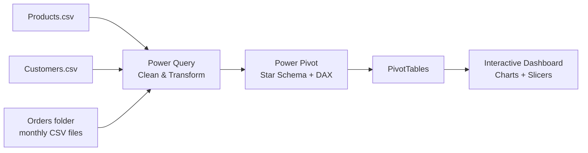

# 🛒 Sales Store Dashboard — Excel (Power Query + Power Pivot)

An end-to-end sales analytics project built entirely in **Microsoft Excel**. Raw CSV files are cleaned and combined with **Power Query**, modeled as a **star schema** in **Power Pivot** with **DAX measures**, summarized with **PivotTables**, and presented in an interactive, dark-themed **dashboard** with slicers.


---

## 📑 Table of Contents

1. [Project Overview](#-project-overview)
2. [Tools & Skills](#-tools--skills)
3. [Workflow](#-workflow)
4. [Data Sources](#-data-sources)
5. [Stage 1 — Data Cleaning (Power Query)](#-stage-1--data-cleaning-power-query)
6. [Stage 2 — Data Modeling (Power Pivot)](#-stage-2--data-modeling-power-pivot)
7. [Stage 3 — PivotTables](#-stage-3--pivottables)
8. [Stage 4 — Dashboard](#-stage-4--dashboard)
9. [Key Insights](#-key-insights)
10. [Repository Structure](#-repository-structure)
11. [How to Use](#-how-to-use)

---

## 📌 Project Overview

A multi-branch retail store sells products across five categories to customers in five Egyptian regions. The raw data arrives as separate CSV files with inconsistent text casing, stray spaces, mixed date formats, text-typed prices and blank rows.

**Goal:** turn this raw data into a clean, reliable model and a one-page dashboard that answers:

- How much did we sell, to how many customers, across how many orders?
- Which months, categories, regions and products perform best and worst?
- How do sales and order volume move over the year?

**Headline numbers**

| Total Sales | Total Orders | Total Customers | Total Quantity | Avg. Sales per Order |
|:-:|:-:|:-:|:-:|:-:|
| $101,111,318 | 19,586 | 300 | 108,087 | ≈ $5,162 |

---

## 🧰 Tools & Skills

| Area | Details |
|---|---|
| **Microsoft Excel** | PivotTables, PivotCharts, Slicers, Timeline, dashboard layout |
| **Power Query (M)** | Import from CSV and folder, combine files, clean text, fix data types, parse dates |
| **Power Pivot** | Data model, star schema, relationships, Calendar table |
| **DAX** | Calculated measures (Total Sales, Total Orders, etc.) |
| **Data visualization** | KPI cards, combo chart, donut, pie, bar and column charts |

---

## 🔄 Workflow



---

## 📂 Data Sources

| Table | Source | Grain | Columns |
|---|---|---|---|
| **Products** | `Products.csv` | One row per product | `ProductID`, `ProductName`, `Category`, `Price` |
| **Customers** | `Customers.csv` | One row per customer | `CustomerID`, `CustomerName`, `Region` |
| **Orders** | `Orders/` folder (one CSV per month) | One row per order line | `OrderID`, `CustomerID`, `ProductID`, `OrderDate`, `Quantity` |

---

## 🧹 Stage 1 — Data Cleaning (Power Query)

All three tables were cleaned in Power Query so the model is built on consistent, correctly typed data. Every transformation is recorded in the query's **Applied Steps**, so the process is repeatable: refresh the workbook and the cleaning re-runs automatically.

### 1.1 Products

| # | Step | Why |
|---|---|---|
| 1 | Import `Products.csv` and **promote headers** | Use the first row as column names |
| 2 | **Change type**: `ProductID` → Whole Number, text columns → Text | Correct data types |
| 3 | **Trim** + **Capitalize Each Word** on `ProductName` | Remove stray spaces and unify casing (e.g. `  lego ` → `Lego`) |
| 4 | **Trim** + **Capitalize Each Word** on `Category` | Prevent the same category appearing as several variants in pivots |
| 5 | **Replace Value** `"Two Hundred"` → `"200"` in `Price` | A price was typed as words, which blocked numeric conversion |
| 6 | **Change type**: `Price` → Currency | Enables sales calculations |

<details>
<summary>📄 View M code — Products</summary>

```powerquery
let
    Source = Csv.Document(File.Contents("...\PowerQuery\Products.csv"),[Delimiter=",", Columns=4, Encoding=1252, QuoteStyle=QuoteStyle.None]),
    #"Promoted Headers" = Table.PromoteHeaders(Source, [PromoteAllScalars=true]),
    #"Changed Type" = Table.TransformColumnTypes(#"Promoted Headers",{{"ProductID", Int64.Type}, {"ProductName", type text}, {"Category", type text}, {"Price", type text}}),
    #"Trimmed Text" = Table.TransformColumns(#"Changed Type",{{"ProductName", Text.Trim, type text}}),
    #"Capitalized Each Word" = Table.TransformColumns(#"Trimmed Text",{{"ProductName", Text.Proper, type text}}),
    #"Trimmed Text1" = Table.TransformColumns(#"Capitalized Each Word",{{"Category", Text.Trim, type text}}),
    #"Capitalized Each Word1" = Table.TransformColumns(#"Trimmed Text1",{{"Category", Text.Proper, type text}}),
    #"Replaced Value" = Table.ReplaceValue(#"Capitalized Each Word1","Two Hundred","200",Replacer.ReplaceText,{"Price"}),
    #"Changed Type1" = Table.TransformColumnTypes(#"Replaced Value",{{"Price", Currency.Type}})
in
    #"Changed Type1"
```

</details>

### 1.2 Customers

| # | Step | Why |
|---|---|---|
| 1 | Import `Customers.csv` and **promote headers** | Use the first row as column names |
| 2 | **Change type**: `CustomerID` → Whole Number, others → Text | Correct data types |
| 3 | **Trim** + **Capitalize Each Word** on `CustomerName` | Consistent name formatting |
| 4 | **Replace Value** `" "` → `""` in `Region`, then **Trim** + **Capitalize Each Word** | Remove stray spaces and unify casing so each region appears only once |
| 5 | **Split Column by Delimiter** (space) on `CustomerName` | Produces separate **first name** and **last name** columns, renamed in the data model |
| 6 | **Change type** of the split columns → Text | Correct data types |

<details>
<summary>📄 View M code — Customers</summary>

```powerquery
let
    Source = Csv.Document(File.Contents("...\PowerQuery\Customers.csv"),[Delimiter=",", Columns=3, Encoding=1252, QuoteStyle=QuoteStyle.None]),
    #"Promoted Headers" = Table.PromoteHeaders(Source, [PromoteAllScalars=true]),
    #"Changed Type" = Table.TransformColumnTypes(#"Promoted Headers",{{"CustomerID", Int64.Type}, {"CustomerName", type text}, {"Region", type text}}),
    #"Trimmed Text" = Table.TransformColumns(#"Changed Type",{{"CustomerName", Text.Trim, type text}}),
    #"Capitalized Each Word" = Table.TransformColumns(#"Trimmed Text",{{"CustomerName", Text.Proper, type text}}),
    #"Replaced Value" = Table.ReplaceValue(#"Capitalized Each Word"," ","",Replacer.ReplaceText,{"Region"}),
    #"Trimmed Text1" = Table.TransformColumns(#"Replaced Value",{{"Region", Text.Trim, type text}}),
    #"Capitalized Each Word1" = Table.TransformColumns(#"Trimmed Text1",{{"Region", Text.Proper, type text}}),
    #"Filtered Rows" = Table.SelectRows(#"Capitalized Each Word1", each true),
    #"Split Column by Delimiter" = Table.SplitColumn(#"Filtered Rows", "CustomerName", Splitter.SplitTextByEachDelimiter({" "}, QuoteStyle.Csv, false), {"CustomerName.1", "CustomerName.2"}),
    #"Changed Type1" = Table.TransformColumnTypes(#"Split Column by Delimiter",{{"CustomerName.1", type text}, {"CustomerName.2", type text}})
in
    #"Changed Type1"
```

</details>

### 1.3 Orders (the most complex query)

Orders arrive as **one CSV file per month** inside a folder, and the `OrderDate` column holds **mixed date formats** (some day-first, some year-first, with both `/` and `-` separators). This table needed the most work.

| # | Step | Why |
|---|---|---|
| 1 | **Folder.Files** → connect to the `Orders` folder | Load every monthly file at once, so new months are picked up on refresh |
| 2 | **Filter hidden files** | Ignore system or hidden files in the folder |
| 3 | **Invoke Custom Function** (`Transform File`) → **Expand** the table column | Combine all monthly files into a single table |
| 4 | **Keep `Source.Name` + data columns**, set data types | Keep the file name (it carries the month) and type each column |
| 5 | **Filter rows**: remove blank / null `ProductID` and `Quantity` | Drop incomplete order lines |
| 6 | **Add Index Column** → remove the old `OrderID` → rename `Index` to `OrderID` | Create a unique, gap-free `OrderID` across all monthly files |
| 7 | **Replace** `/` with `-` in `OrderDate` | Standardize the date separator |
| 8 | **Split `OrderDate` by `-`** into 3 parts → set type to Whole Number | Separate the date components so each can be identified |
| 9 | **Add Conditional Column `year`**: the part greater than 31 is the year | A value above 31 can only be a year, whichever position it is in |
| 10 | **Extract the month** from the file name (text between `_` and `.`) → rename to `Month` | The month is taken from the source file, since the date text is ambiguous |
| 11 | **Add Custom Column `Day`**: the first remaining part ≤ 31 that is not equal to `Month`; otherwise `Month` | Resolve the day when day and month are both ≤ 12 (and when they are equal) |
| 12 | **Remove** the three temporary `OrderDate.*` columns | Clean up helper columns |
| 13 | **Merge Columns** `Day-Month-year` → `New Date` | Rebuild a single date value |
| 14 | **Change type to Date** using an explicit locale (`en-SZ`) | Parse `Day-Month-Year` consistently regardless of the machine's regional settings |

<details>
<summary>📄 View M code — Orders</summary>

```powerquery
let
    Source = Folder.Files("...\PowerQuery\Orders"),
    #"Filtered Hidden Files1" = Table.SelectRows(Source, each [Attributes]?[Hidden]? <> true),
    #"Invoke Custom Function1" = Table.AddColumn(#"Filtered Hidden Files1", "Transform File", each #"Transform File"([Content])),
    #"Renamed Columns1" = Table.RenameColumns(#"Invoke Custom Function1", {"Name", "Source.Name"}),
    #"Removed Other Columns1" = Table.SelectColumns(#"Renamed Columns1", {"Source.Name", "Transform File"}),
    #"Expanded Table Column1" = Table.ExpandTableColumn(#"Removed Other Columns1", "Transform File", Table.ColumnNames(#"Transform File"(#"Sample File"))),
    #"Changed Type" = Table.TransformColumnTypes(#"Expanded Table Column1",{{"Source.Name", type text}, {"OrderID", Int64.Type}, {"CustomerID", Int64.Type}, {"ProductID", Int64.Type}, {"OrderDate", type text}, {"Quantity", Int64.Type}}),
    #"Filtered Rows" = Table.SelectRows(#"Changed Type", each [ProductID] <> null and [ProductID] <> ""),
    #"Filtered Rows1" = Table.SelectRows(#"Filtered Rows", each [Quantity] <> null and [Quantity] <> ""),
    #"Added Index" = Table.AddIndexColumn(#"Filtered Rows1", "Index", 1, 1, Int64.Type),
    #"Removed Columns" = Table.RemoveColumns(#"Added Index",{"OrderID"}),
    #"Renamed Columns" = Table.RenameColumns(#"Removed Columns",{{"Index", "OrderID"}}),
    #"Reordered Columns" = Table.ReorderColumns(#"Renamed Columns",{"Source.Name", "OrderID", "CustomerID", "ProductID", "OrderDate", "Quantity"}),
    #"Replaced Value" = Table.ReplaceValue(#"Reordered Columns","/","-",Replacer.ReplaceText,{"OrderDate"}),
    #"Split Column by Delimiter" = Table.SplitColumn(#"Replaced Value", "OrderDate", Splitter.SplitTextByDelimiter("-", QuoteStyle.Csv), {"OrderDate.1", "OrderDate.2", "OrderDate.3"}),
    #"Changed Type1" = Table.TransformColumnTypes(#"Split Column by Delimiter",{{"OrderDate.1", Int64.Type}, {"OrderDate.2", Int64.Type}, {"OrderDate.3", Int64.Type}}),
    #"Added Conditional Column" = Table.AddColumn(#"Changed Type1", "year", each if [OrderDate.1] > 31 then [OrderDate.1] else if [OrderDate.3] > 31 then [OrderDate.3] else "not found"),
    #"Filtered Rows2" = Table.SelectRows(#"Added Conditional Column", each true),
    #"Extracted Text Between Delimiters" = Table.TransformColumns(#"Filtered Rows2", {{"Source.Name", each Text.BetweenDelimiters(_, "_", "."), type text}}),
    #"Changed Type2" = Table.TransformColumnTypes(#"Extracted Text Between Delimiters",{{"Source.Name", Int64.Type}}),
    #"Renamed Columns2" = Table.RenameColumns(#"Changed Type2",{{"Source.Name", "Month"}}),
    #"Reordered Columns1" = Table.ReorderColumns(#"Renamed Columns2",{"OrderID", "CustomerID", "ProductID", "OrderDate.1", "OrderDate.2", "OrderDate.3", "Quantity", "year", "Month"}),
    #"Added Custom" = Table.AddColumn(#"Reordered Columns1", "Day", each if [OrderDate.1]<=31 and [OrderDate.1]<>[Month] then [OrderDate.1]
else if [OrderDate.2]<=31 and [OrderDate.2]<>[Month] then [OrderDate.2]
else if [OrderDate.3]<=31 and [OrderDate.3]<>[Month] then [OrderDate.3]
else [Month]),
    #"Filtered Rows3" = Table.SelectRows(#"Added Custom", each true),
    #"Removed Columns1" = Table.RemoveColumns(#"Filtered Rows3",{"OrderDate.1", "OrderDate.2", "OrderDate.3"}),
    #"Merged Columns" = Table.CombineColumns(Table.TransformColumnTypes(#"Removed Columns1", {{"Day", type text}, {"Month", type text}, {"year", type text}}, "en-US"),{"Day", "Month", "year"},Combiner.CombineTextByDelimiter("-", QuoteStyle.None),"New Date"),
    #"Changed Type with Locale" = Table.TransformColumnTypes(#"Merged Columns", {{"New Date", type date}}, "en-SZ"),
    #"Filtered Rows4" = Table.SelectRows(#"Changed Type with Locale", each true)
in
    #"Filtered Rows4"
```

</details>

### Cleaning summary

| Issue found | Fix applied |
|---|---|
| Inconsistent text casing and extra spaces | `Text.Trim` + `Text.Proper` |
| Price typed as text, including `"Two Hundred"` | Replace value, then Currency type |
| Region names with stray spaces | Replace + Trim + Proper |
| Full names in one column | Split into first / last name |
| Monthly files in a folder | `Folder.Files` + custom function to combine |
| Blank `ProductID` / `Quantity` rows | Filtered out |
| Duplicate / unreliable `OrderID` across files | Rebuilt with an Index column |
| Mixed date formats | Split, identify year/month/day, merge, convert to Date |

---

## 🧱 Stage 2 — Data Modeling (Power Pivot)

The cleaned queries were loaded to the **Excel Data Model** and arranged as a **star schema**: one central fact table (`Orders`) surrounded by three dimension tables.


### Tables

| Table | Type | Key columns |
|---|---|---|
| **Orders** | Fact | `OrderID`, `CustomerID`, `ProductID`, `Quantity`, `New Date` |
| **Products** | Dimension | `ProductID`, `ProductName`, `Category`, `Price` |
| **Customers** | Dimension | `CustomerID`, first name, last name, `Region` |
| **Calendar** | Dimension (date table) | `Date`, `Year`, `Month Number`, `Month`, `MMM-YYYY`, `Day Of Week Number`, `Day Of Week`, Date Hierarchy (Year → Month → Date) |

### Relationships

| From (one side) | To (many side) | Join column | Cardinality |
|---|---|---|---|
| `Products` | `Orders` | `ProductID` | 1 : * |
| `Customers` | `Orders` | `CustomerID` | 1 : * |
| `Calendar` | `Orders` | `Date` ↔ `New Date` | 1 : * |

### DAX measures (in the `Orders` table)

| Measure | Purpose |
|---|---|
| **Total Sales** | Revenue = quantity × product price |
| **Total Quantity** | Units sold |
| **Total Order** | Number of orders |
| **Total Customer** | Number of distinct customers |
| **Total Average** | Average sales per order (Total Sales ÷ Total Order) |

<details>
<summary>📄 Reference DAX (adjust to match your workbook)</summary>

```dax
Total Sales    = SUMX ( Orders, Orders[Quantity] * RELATED ( Products[Price] ) )
Total Quantity = SUM ( Orders[Quantity] )
Total Order    = DISTINCTCOUNT ( Orders[OrderID] )
Total Customer = DISTINCTCOUNT ( Orders[CustomerID] )
Total Average  = DIVIDE ( [Total Sales], [Total Order] )
```

</details>

**Why a star schema?** It keeps dimension data in one place, makes filtering from Category, Region or Month flow cleanly into the fact table, and keeps the DAX measures simple and fast.

---

## 📊 Stage 3 — PivotTables

Every dashboard number and chart is driven by a PivotTable connected to the Data Model.


| PivotTable | Rows | Values |
|---|---|---|
| Sales by Category | Category | Total Sales |
| Orders by Region | Region | Total Order |
| Sales by Region (store branch) | Region | Total Sales |
| Customers by Region | Region | Total Customer |
| Top 5 Products | ProductName (Top 10 filter, by Total Sales) | Total Sales |
| Bottom 5 Products | ProductName (Bottom filter, by Total Sales) | Total Sales |
| Monthly performance | Month | Total Order, Total Sales, Total Average |
| KPI cards | — | Total Order, Total Quantity, Total Customer, Total Sales |

---

## 🖥️ Stage 4 — Dashboard

The dashboard is built from PivotCharts and KPI cards linked to the PivotTables above, with a dark / gold theme and a filter panel.


### Components

| Section | Content |
|---|---|
| **KPI cards** | Total Sales, Total Customer, Total Order, Total Quantity |
| **Filter panel** | Slicers for **Category**, **ProductName** and **Region**, plus a **Timeline** for months |
| **Sales & Order over Monthly** | Combo chart: sales as columns, order count as a smoothed line |
| **Total Sales by Category** | Donut chart with share of sales per category |
| **Sales by Store Branch** | Column chart of sales per region |
| **Customer by Region** | Column chart of customers per region |
| **Total Order by Region** | Pie chart of orders per region |
| **Top 5 Products** | Bar chart of best sellers |
| **Bottom 5 Products** | Bar chart of weakest sellers |
| **Key Highlights & Business Insights** | Text summaries of best/worst month, top region and top product |

All slicers are connected to every PivotTable, so one click re-filters the whole dashboard.

---

## 💡 Key Insights

| Area | Finding |
|---|---|
| **Best month** | May — $8,659,916 in sales |
| **Lowest month** | December — $8,286,294 in sales |
| **Top region** | Mansoura — $21,015,213 in sales (also the most orders, 4,046, and customers, 62) |
| **Lowest region** | Alexandria — $18,662,760 in sales |
| **Top category** | Clothing — $29.1M (29% of sales), followed by Toys — $25.4M (25%) |
| **Smallest category** | Furniture — $10.4M (10% of sales) |
| **Top 5 products** | Doll ($8.15M), Shirt ($7.21M), Pants ($6.57M), Tablet ($6.35M), Shoes ($6.32M) |
| **Bottom 5 products** | Sofa ($0.26M), Headphone ($0.89M), Chair ($1.93M), Notebook ($1.98M), Lego ($2.06M) |
| **Order volume** | Stable at roughly 1,620–1,640 orders per month |

**Takeaways**

- Sales are spread fairly evenly across the five regions, so no single branch carries the business.
- Clothing and Toys together account for over half of revenue; Furniture and low-priced products such as Sofa underperform.
- Monthly orders barely move, so the month-to-month swing in sales is driven mainly by the product mix and the value of each order rather than by order count.

---

## 🗂️ Repository Structure

```
├── Sales_Store_Dashboard.xlsx      # Final workbook (Power Query + Power Pivot + Dashboard)
├── data/
│   ├── Products.csv
│   ├── Customers.csv
│   └── Orders/                     # One CSV per month
├── power-query/
│   ├── Products.m
│   ├── Customers.m
│   └── Orders.m
├── images/
│   ├── power-pivot-star-schema.png
│   ├── pivot-tables.png
│   └── sales-dashboard.png
└── README.md
```

---

## ▶️ How to Use

1. Download the repository and open `Sales_Store_Dashboard.xlsx` in **Excel 2016 or later** (desktop version, Windows recommended, since Power Pivot is required).
2. If you want to refresh the data, open **Data → Queries & Connections**, edit each query's **Source** step, and point it to your local `data/` folder (the original paths were on a local drive).
3. Click **Data → Refresh All**. The cleaning steps re-run and the Data Model, PivotTables and dashboard update automatically.
4. Use the slicers and timeline on the left of the dashboard to explore the data.

---

## 👤 Author

**Your Name** — add your LinkedIn / GitHub / email here.

⭐ If you found this project useful, consider giving the repository a star.
